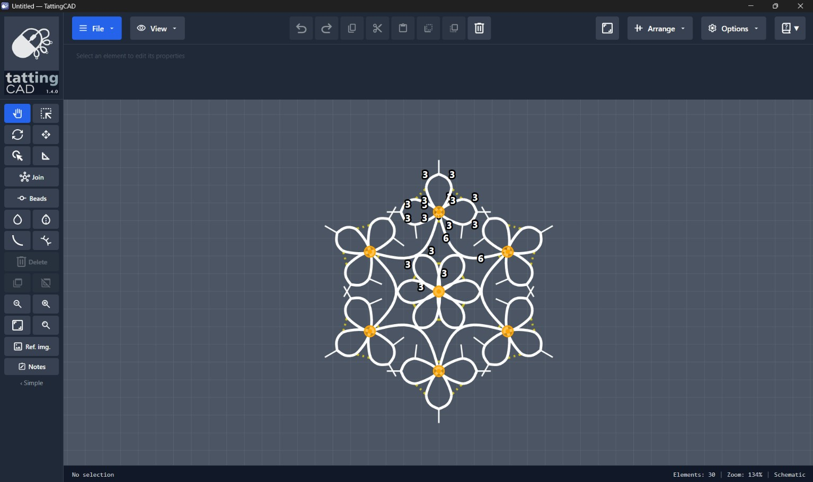

# TattingCAD

A pattern design tool for needle and shuttle tatters.  
Built because nothing like it existed.

> **Tatting** is a form of lace-making worked with a shuttle or needle, building rings and chains from a series of knots. TattingCAD lets you design, annotate, and export tatting patterns on a digital canvas.



**Current version:** 1.4.0 &nbsp;|&nbsp; Windows · Linux · macOS · Android &nbsp;|&nbsp; Free, forever

---

## Get it

| Platform | Notes |
|---|---|
| Windows | Installer — ready to run |
| Ubuntu | `.deb` and `.AppImage` |
| macOS | Unsigned — allow it manually in **System Settings → Privacy & Security** |
| Android | Unsigned APK — enable **Install from unknown sources** in your settings |

No account. No cloud. No trackers. Everything stays on your device.

⚠️ Installation Notes:
TattingCAD is an independent release and the installers are currently unsigned. 
This means your OS may show a security warning — this is expected and safe to dismiss.

🪟 Windows: When prompted by SmartScreen, click More info → Run anyway.

🍎 macOS: Apple blocks unsigned apps by default. To open TattingCAD:
  Download the .dmg and drag TattingCAD to your Applications folder
  Fix “can’t open app” on macOS (Terminal method)
  1) Open Finder
  2) Go to Applications
  3) Find TattingCAD.app
  4) Open Terminal: (Press Cmd + Space, Type: Terminal, Press Enter)
  5) Copy and paste this command into Terminal: xattr -cr /Applications/TattingCAD.app
  6) Press Enter
  7) Close Terminal
  8) Open TattingCAD normally from Applications

📱 Android: Enable Install from unknown sources in your device settings, then open the .apk file to install.

**Updating:** install the new version over the old one. Your settings, recent files and patterns stay. When an installer offers to delete application data, leave that unticked.
---

## New in 1.4

- **Pattern files are now `.tatcad`.** They get their own icon, and double-clicking one opens it in TattingCAD. Old `.json` patterns still open. `.tatcad` extension need 1.4 or later to open it - by renaming it back to `.json` 1.3 would be able to open them.
- **Setup screen** on first start: language, Simple or Full toolbar, Normal or Large size UI, background, colors. Reopen it from Options → Setup….
- **Sample patterns** to explore, from the welcome screen or the Help menu.
- **Picot Tools redesigned,** with a preview of the result, and now working on split rings.
- **A ruler that follows curves**, and the thread length of folded picots.
- **Add your own language** without waiting for an update (see Localization).

The full list is in the release notes.

---

## Features

- Rings, chains, split rings and split chains, with picots, joins and folded picots
- Thread presets for needle or shuttle tatting: approximate measurements and the materials needed
- Tatting Order mode — number elements or mark them repeated across named rounds
- Generates written notation from your diagram
- Realistic and schematic rendering modes
- Picot Tools: add, fill, group and expand repeats, scale, reverse, clear
- Ruler (several points, follows curves) in px, mm, cm and inches
- Polar grids
- Linear, Polar and Spiral Arrays
- Full material library (DMC thread colors, Lizbeth colors + gradients)
- SVG export

**Beads**
- Beads as BE elements (core, spike, suspended, beaded picots) or written inline in the notation
- Bead library with sizes, colours and shapes; beads on joins drawn on the join line

**Pattern**
- Tatting Order mode — number elements across named rounds
- Generates written notation from your diagram
- Pattern notes
- SVG export for schematic and realistic views — close to ready for publishing

**ETC**
- Simple toolbar for beginners, Full toolbar with every tool
- Beginner hints and sample patterns
- Large size for anyone who wants bigger text and controls
- Colour-blind friendly colours, or your own
- Works (technically) on phones and tablets: tool bar within thumb reach, pinch and two-finger pan


---

## Localization

Currently available in **English** and **Hungarian**.  
A **Spanish** translation exists but is AI-generated and has not been reviewed by a native speaker.

**Add or change a language yourself (desktop app):** Options → **Add or edit languages…** opens a folder with step-by-step instructions and a file of every English text. Translate it, restart TattingCAD, and your language appears in the list. No new version of the app needed, and you only have to translate what you want — anything left out is shown in English.

For developers and translators:

- `INFO_LOCALIZATION.md` — how the translation system works
- `INFO_translation-reference.md` — craft terminology reference (EN / HU / ES, with Japanese notes)
- `TOOL_translator_helper.html` — browser-based tool for manual translation or updating existing keys

If you're a native speaker of any language and want to contribute a translation, that would be very welcome — send the file and it can be included for everyone.

---

## For the programmers

This was built with AI assistance over 60 sessions. I'm a former game designer and crafter, not a developer. I treated the AI the way I'd treat a programmer on a project — design in, spec out, iterate.

The code is what it is. I'd genuinely love to know what you think.

**To build from source:**

```bash
# Requirements: Node 24+, Rust stable, Tauri 2.12 or newer
npm install
npm run tauri build

# Android (needs the Android SDK + NDK set up for Tauri)
npm run tauri android build -- --target aarch64 --apk
```

On Linux, install the WebKit dependencies first:

```bash
sudo apt-get install -y libwebkit2gtk-4.1-dev libappindicator3-dev librsvg2-dev patchelf
```

Built with [Tauri v2](https://tauri.app/) + React + TypeScript.

Pattern files (`.tatcad`) are plain JSON — open one in any text editor to see how a pattern is stored.

**Bug reports and feedback:** open a [GitHub Issue](../../issues) — or if it's more of a thought than a bug, [contact me](https://savarosacraft.com/contact/) through my website.

---

## Support

If it's been useful, you can tip me on Ko-fi.  
No pressure. It's free and will stay free.

[ko-fi.com/savarosacraft](https://ko-fi.com/savarosacraft)

---
## FAQ

[Read the FAQ](https://savarosacraft.com/tattingcad-faq/) on my website.

---

*Made by SavarosaCraft*
